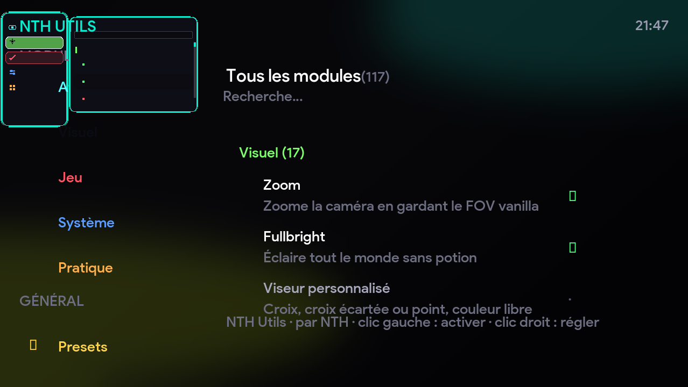
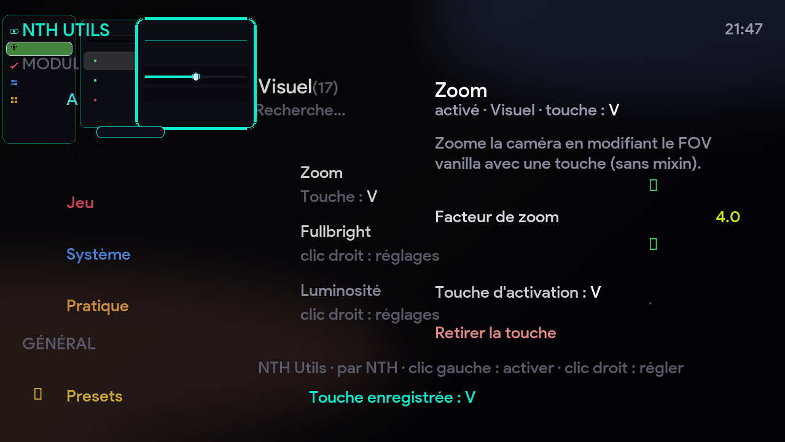
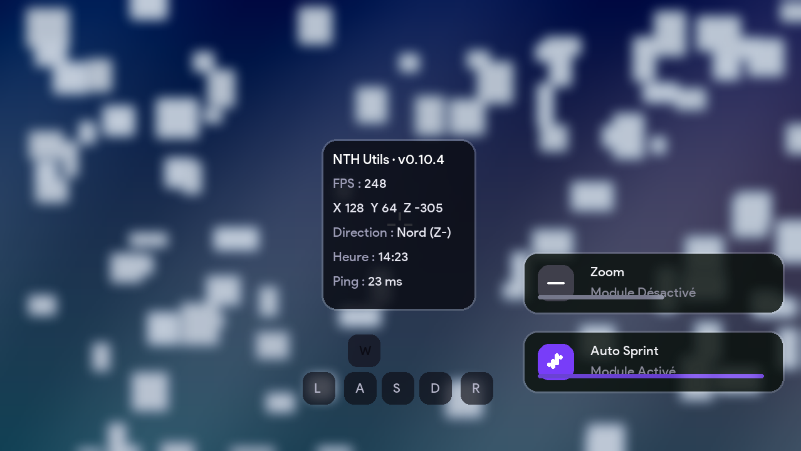
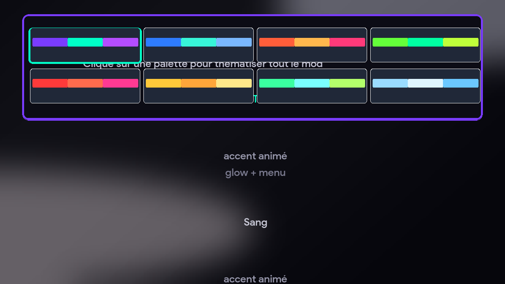

# ⛏ NTH Utils

**Mod utilitaire client pour Minecraft (Fabric)** — un seul menu in-game (**Maj droite** par défaut) pour personnaliser ton jeu : modules activables d'un clic, réglages à la volée, presets exportables. Le tout en français. 🇫🇷

🌐 **Site de téléchargement** : https://nth-oficiell.github.io/test/ (choisis ton launcher + ta version, et récupère le jar).

## 🖼 Captures d'écran

| | |
|---|---|
| **Menu principal** (rail à la Corz : 5 catégories + Presets, header horloge, modules 2 lignes) | **Paramètres d'un module** (clic droit : sliders, toggles, keybind) |
|  |  |
| **HUD en jeu** (dégradés + Keystrokes) | **Palettes de thème** (accent animé, à la CorzClient) |
|  |  |

## 📦 Versions disponibles

| Version de Minecraft | Loader | Fichier |
|---|---|---|
| 1.20.4 | Fabric (mappings Yarn) | `utilikit-1.20.4-v*` |
| 1.20.6 | Fabric (mappings Yarn) | `utilikit-1.20.6-v*` |
| 1.20.1 | Fabric (mappings Yarn) | `utilikit-1.20.1-v*` |
| 1.21.1 | Fabric (mappings Yarn) | `utilikit-1.21.1-v*` |
| 1.21.5 | Fabric (mappings Yarn) | `utilikit-1.21.5-v*` |
| 1.21.8 | Fabric (mappings Yarn) | `utilikit-1.21.8-v*` |
| 1.21.11 | Fabric (mappings Yarn) | `utilikit-1.21.11-v*` |
| 26.1.2 | Fabric (noms officiels Mojang) | `utilikit-26.1.2-v*` |
| 26.2 | Fabric (noms officiels Mojang) | `utilikit-26.2-v*` |
| 26.3 | Fabric (noms officiels Mojang) | `utilikit-26.3-v*` |

### 🔓 La solution 26.x

Depuis **26.1**, Minecraft n'est **plus obfusqué** : le jeu sort avec les noms de classes officiels de Mojang et Yarn n'est plus maintenu au-delà de 1.21.11. Les sous-projets 26.x compilent donc **sans aucune mappings** avec le nouveau plugin Loom non-remap (`net.fabricmc.fabric-loom`), en ciblant les **noms officiels Mojang** (`Minecraft`, `LocalPlayer`, `GuiGraphicsExtractor`, `HudElementRegistry`…). Résultat : les 10 versions sont supportées en parallèle, avec les mêmes 117 modules. |

> Les jars exacts et leur dernière version sont listés sur le site (ils sont générés par les builds GitHub Actions de ce dépôt).

## 🧩 Modules (117)

| Catégorie | Exemples |
|---|---|
| Affichage (49) | Air, Altitude, Angles de vue, Armure, Biome, Bloc sous les pieds, Boussole, CPS, Chrono, Chunk, Chunk local, Clics totaux, Compteur de pas, Coordonnées, Dimension, Direction visuelle, Distance parcourue, Durabilité, Durabilité en main, Effets actifs, Empilement max main, Entités proches, FPS info, FPS min/moy/max, Faim, HUD Infos, Heure du monde, Heure réelle, Jour du monde, Jour écoulé, Keystrokes, Lumière, Main secondaire, Météo, Niveau XP, Objet en main, Phase de lune, Pièces d'armure, Position arrondie, Progression XP, Période, Saturation, Temps de session, Vie, Vie monture, Vitesse, Vitesse km/h, Vitesse verticale, XP total |
| Visuel (17) | Anti Orage, Anti Pluie, Caméra lisse, Couleur du HUD, Distance de rendu, Dégradés, FOV personnalisé, FullBright, Limite FPS, Luminosité réglage, No Hurt Cam, Position du HUD, Radar joueurs, Rareté de l'objet, Sensibilité souris, Viseur personnalisé, Zoom |
| Jeu (19) | Accroupi, Auto Sprint, Bloc visé, Distance de visée, Durabilité % main, Dégâts récents, En feu, Entité visée, Entité visée (pos), Face visée, Hauteur de chute, Position visée, Quantité en main, Recharge d'attaque, Sous l'eau, Sprint, Vie visée, Vol, Véhicule |
| Système (17) | Difficulté, Marque du serveur, Mode de jeu, Mods chargés, Mémoire (RAM), Ping HUD, Ping détaillé, Pseudo, Résolution écran, Serveur, Solo / Multi, Système, Taille interface, UUID, Version Fabric, Version Java, À propos |
| Pratique (15) | Alerte durabilité, Alerte faim, Alerte vie, Anti AFK, Chrono reset, Coordonnées Nether, Copier Coordonnées, Distance au 0,0, Log de chat, Mention chat, Message auto, Optimiseur FPS, Plein écran, Reconnexion auto, Sons d'interface |

Chaque module a ses réglages (toggles, sliders) dans le menu in-game, sauvegardés automatiquement et exportables via presets. Nouveaux : **Dégradés** (couleurs hex personnalisables du HUD et du menu) et **Optimiseur FPS** (particules, nuages, ombres, distance de simulation…).

## 🎮 Utilisation

1. Installe **Fabric Loader** (compatible avec ton launcher) + **Fabric API** pour ta version.
2. Glisse le jar NTH Utils dans le dossier `mods`.
3. Lance le jeu, appuie sur **Maj droite** pour ouvrir le menu.
4. Dans le menu : **clic gauche** sur un module pour l'activer/désactiver, **clic droit** pour ouvrir ses paramètres complets (sliders, toggles) et y configurer une **touche d'activation** personnalisée (clique sur « Touche d'activation » puis appuie sur la touche ; Échap annule). La liste des modules se **défile à la molette** (barre de scroll à droite de la liste). Onglet **Presets** pour sauvegarder et partager ta config (export/import via le presse-papiers, touches incluses).

Raccourcis (rebindables dans les options du jeu) :
- **Maj droite** — ouvrir le menu NTH Utils
- **C** — maintenir pour zoomer (si module Zoom activé)
- **O** — copier tes coordonnées

## 🛠 Développement

Projet Gradle multi-versions : un cœur partagé (`common/`) + un sous-projet par version de Minecraft. Les sous-projets 1.20.x/1.21.x utilisent Yarn ; les 26.x utilisent les noms officiels Mojang, sans mappings.

```bash
gradle build                    # compile TOUTES les versions
gradle :fabric-1.21.1:build     # une seule version
```

Chaque sous-projet `fabric-X` contient le code client dépendant de la version (entrypoint, écran, modules impl, mixins) et compile aussi le cœur commun depuis `common/src/main/java`.

## 📄 Licence

MIT
